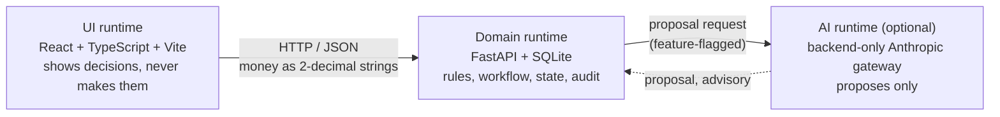
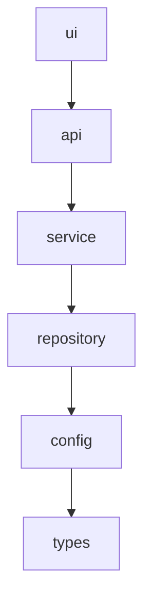
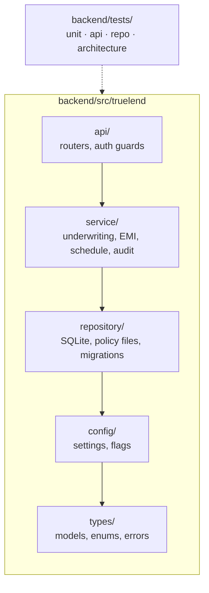
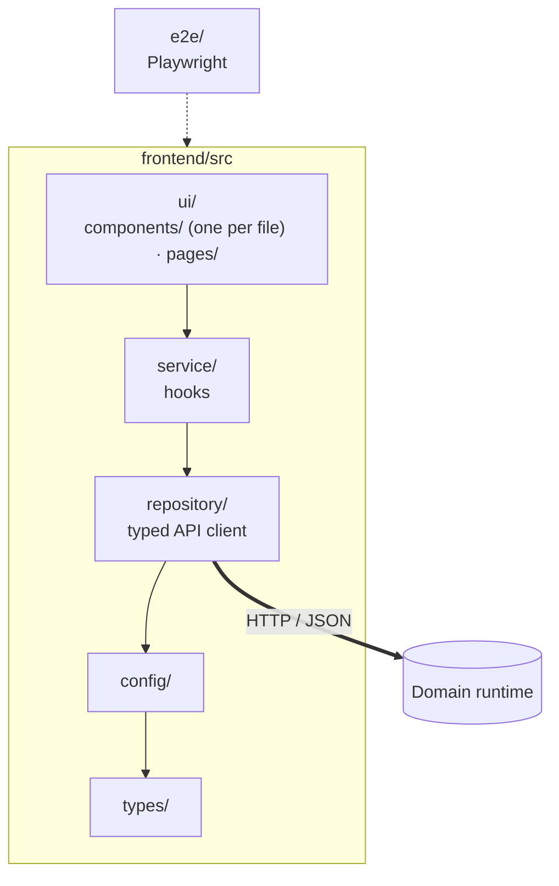

# Architecture

TrueLend has three runtimes and one layer stack. Rules and verification commands for the stack are in `.claude/architecture.md`; this page is the map.

## Three runtimes

AI proposes, the domain decides. Every decision (rules, workflow, state, audit) is made in the Domain runtime, and the system works fully with the AI runtime off.

- The UI never calls the AI runtime. There is no AI path from the browser.
- The API key lives in the backend config and is never sent to the UI.
- With the AI runtime off, the Domain returns the same decisions; only the optional proposals are absent.

## Layer stack

Both codebases use the same layers, lowest to highest. A layer may import only from layers below it.

| Layer | Backend (`backend/src/truelend/<layer>`) | Frontend (`frontend/src/<layer>`) |
|-------|------------------------------------------|-----------------------------------|
| `types` | Domain models, enums, typed errors | Shared TypeScript types |
| `config` | Settings, feature flags, constants | Env and constants |
| `repository` | SQLite access, policy and migration files | The typed API client (the only code that calls `fetch`) |
| `service` | Rules, workflow, EMI and schedule maths, audit | Hooks that fetch and shape data |
| `api` | FastAPI routers, auth guards, request mapping | Unused (see note) |
| `ui` | Not present | `ui/components/`, `ui/pages/` |

Layer names are singular (`service`, not `services`). The frontend is the Domain's client, so the HTTP layer the backend calls `repository` is what the frontend calls its API client.

Note: the frontend `api/` layer is unused; the client lives under `repository` and the hooks under `service`. `project-manifest.json` declares one shared layer order (`types`, `config`, `repository`, `service`, `api`, `ui`) for both codebases, which already fits this mapping.

## Backend

- Money is `Decimal` in every layer and strings on the wire; never `float`.
- Policy files in `policies/` and migrations in `migrations/` are append-only.
- Audit entries are written in the action's own transaction, from `service`.
- Auth is checked at the router in `api`.

## Frontend

- Components in `ui/components/` call hooks, not the client. Hooks in `service/` call the client in `repository/`.
- Money is displayed from the API's strings; no `Number` arithmetic.
- Screens are checked at 375×812 and 1280×800 with no horizontal scroll.

## Sources

`docs/brief/*.pdf`, `specs/app_spec.md` and `docs/business-case.md` are the sources of truth. If this page and the spec disagree, the spec wins.
