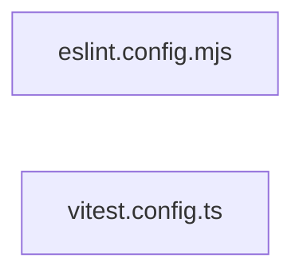

# `frontend/` — 2 module(s)

2 module(s).

## Dependencies

## `js:frontend/eslint.config.mjs`

- fan-in: 0, fan-out: 2

### Symbols
  _(no extracted symbols)_

## `ts:frontend/vitest.config.ts`

- fan-in: 0, fan-out: 1

### Symbols
  _(no extracted symbols)_
