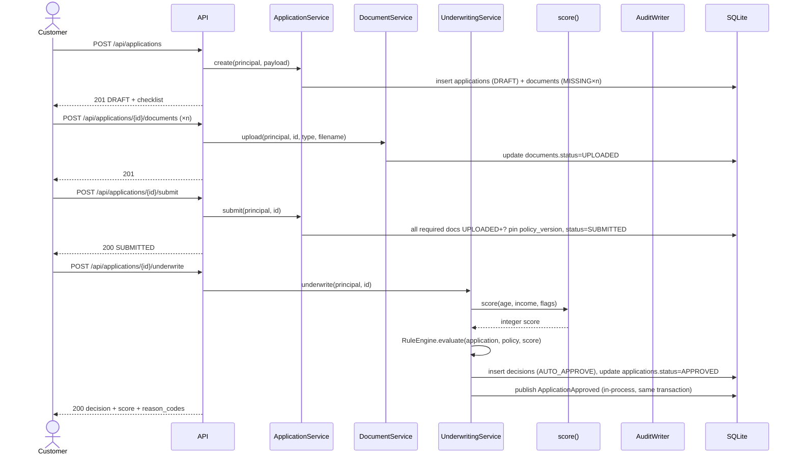

# Architecture — TrueLend M1 (E1–E4)

Scope: epics E1 (platform), E2 (catalog, apply, documents), E3 (scoring,
underwriting, review/override), E4 (policy versions). Repayment, disbursement,
admin dashboard and the applications list (F4/F5) are M2 and are **not**
designed here. Source of truth when this disagrees with a feature spec:
`specs/app_spec.md`, then `specs/features/F0..F3.md`, then this document.

## Recorded decisions

Every row is load-bearing from `specs/decisions/design-decisions.json` and
binds the rest of this design set. `rules_out` is a prohibition, not a
preference — a document or diff proposing a ruled-out option is wrong even if
it works.

| ID | Decision | Rules out |
|----|----------|-----------|
| D-A | Repository layer talks to SQLite via stdlib `sqlite3` with parameterized SQL; numbered SQL migration files checksummed with SHA-256; DB triggers abort `UPDATE`/`DELETE` on approved policies and on `audit_log`. | ORMs, Alembic autogenerate/revisable migrations, any query builder that would hide SQL from the append-only triggers. |
| D-B | Frontend is a Vite SPA: React Router role-based routes, TanStack Query for server state, CSS modules over `:root` token custom properties, hand-built SVG charts, one component per file. | Tailwind utility classes in production code, Redux/global client stores for server data, any third-party chart library. |
| D-C | Cross-epic seams (`AuthPrincipal`, `AuditWriter`, `ScoreFunction`) are typed Protocols declared in the Types layer; E1/E3 supply the concrete implementations, everything downstream depends only on the Protocol. | Services importing API-layer guards or concrete audit/score modules directly; adding separate "interface" stories ahead of design. |
| D-D | Single local run is `init.sh` driving Docker Compose (migrations + seeds run before ready); a no-Docker `uv` + `npm` path stays available for the inner dev loop. | Kubernetes, hosted deployment, any manual multi-step bootstrap. |
| D-E | Code is organised one package per layer on each side: `backend/src/truelend/{types,config,repository,service,api}` and `frontend/src/{types,config,service,api,ui}`; features are modules inside each layer. Matches `project-manifest.json#architecture.layer_roots`. | Feature-first vertical packages, any import from a higher layer. |
| D-F | Money is integer paise in SQLite, `Decimal` in the Service layer, JSON strings with exactly 2 decimals on the wire; UI formats strings with no `Number` arithmetic; a static scan fails the build on float in money code. | `REAL` columns, float/`Number` arithmetic on money anywhere, rounding outside one shared `Decimal` helper. |
| D-G | Auth is bearer JWT HS256, 1800 s lifetime, secret from `TRUELEND_JWT_SECRET`, salted password hashes, a router-level dependency enforcing role at the API layer. | Server-side session stores, an external identity provider, role checks living only in a service or the UI. |
| D-H | No AI code in M1; a later gateway (if built) is backend-only behind a service interface — it proposes, the domain decides — and every M1 flow works with it off. | AI calls from the UI, AI output deciding an application, any domain import of an Anthropic SDK. |

**Resolving the D-C seams against the sprint micro-DAG.** `specs/stories/story-clusters.json`
flags `IC-1/2/5/6/7/9/10` as contracts with "no interface-layer story to
publish" them, which would otherwise block C3/C4 on C1/C6 shipping first.
D-C's answer: the three Protocols (`AuthPrincipal`, `AuditWriter`,
`ScoreFunction`) are pure type declarations in
`backend/src/truelend/types/contracts.py`, committed once at scaffold time
(zero business logic, no story owns it as a deliverable). Every consuming
story codes against the Protocol from day one; only the **wiring** of a
concrete implementation into the FastAPI dependency graph in `api/deps.py`
waits on the owning story (E1-S1 for `AuthPrincipal`, E1-S2 for
`AuditWriter`, E3-S2 for `ScoreFunction`). This turns a story-level blocking
dependency into a type-level one, which is why C3 and C4 are
`independently_startable: true` in the cluster file.

## Sequence — apply through decision (happy path, AUTO_APPROVE)



## Sequence — verification, manual review, override (audited actions)

```mermaid
sequenceDiagram
    actor Underwriter
    actor Admin
    participant API
    participant VQ as VerificationService
    participant Rev as ReviewService
    participant Ovr as OverrideService
    participant Audit as AuditWriter
    participant DB as SQLite

    Underwriter->>API: GET /api/verification-queue
    API->>VQ: list(principal)
    VQ->>DB: select documents where status=UPLOADED order by uploaded_at
    API-->>Underwriter: items[]

    Underwriter->>API: POST /api/documents/{id}/verify {VERIFIED|REJECTED, reason}
    API->>VQ: decide(principal, id, outcome, reason)
    VQ->>DB: update documents.status, in one transaction: Audit.write(DOCUMENT_VERIFIED|REJECTED)
    API-->>Underwriter: 200

    Underwriter->>API: POST /api/applications/{id}/review {APPROVE|REJECT, reason}
    API->>Rev: resolve(principal, id, outcome, reason)
    Rev->>DB: insert resolutions, update applications.status; Audit.write(REVIEW_APPROVED|REVIEW_REJECTED)
    Rev->>DB: publish ApplicationApproved if APPROVED (same transaction)
    API-->>Underwriter: 200

    Admin->>API: POST /api/applications/{id}/override {reason_code, comment}
    API->>Ovr: override(principal, id, reason_code, comment)
    Ovr->>DB: insert resolutions(kind=OVERRIDE), update applications.status=APPROVED (decisions row unchanged)
    Ovr->>DB: Audit.write(DECISION_OVERRIDDEN, before, after); publish ApplicationApproved
    API-->>Admin: 200
```

## Components by layer

| Layer | Module | Responsibility |
|---|---|---|
| Types | `types/enums.py` | `Role`, `ApplicationStatus`, `DocumentStatus`, `DecisionType`, `ResolutionKind`, `PolicyStatus`. |
| Types | `types/contracts.py` | `AuthPrincipal`, `AuditWriter`, `ScoreFunction` Protocols (D-C); `DomainEvent`/`ApplicationApproved`. |
| Types | `types/errors.py` | `DomainError` base and named subclasses (`PolicyViolationException`, `ValidationError`, `ConflictError`, `NotFoundError`) each carrying an error `code`. |
| Types | `types/money.py` | `Money` = `NewType("Money", Decimal)`; no behavior, just the type alias the static float-scan keys off. |
| Config | `config/settings.py` | Env (`TRUELEND_JWT_SECRET`, DB path, seed flag), app configuration. |
| Config | `config/logging.py` | JSON log formatter, request-scoped correlation ID context var, redaction filter (FA-F0.6/F0.7). |
| Config | `config/errors.py` | Error-envelope exception handlers mapping `DomainError` → HTTP status + `{error:{code,message,correlation_id}}`. |
| Config | `config/db.py` | SQLite connection factory, migration runner (checksum-verified), seed loader. |
| Config | `config/money.py` | `paise_to_decimal`, `decimal_to_paise`, `decimal_to_wire` — the one shared rounding/formatting helper D-F requires. |
| Repository | `repository/users_repo.py` | `UsersRepo` — lookup by email/id for auth. |
| Repository | `repository/audit_repo.py` | `AuditRepo` — implements `AuditWriter`; insert-only, filtered read for `/api/audit`. |
| Repository | `repository/policy_repo.py` | `PolicyRepo` — `policy_versions` rows plus policy JSON file read/write and SHA-256 verification. |
| Repository | `repository/applications_repo.py` | `ApplicationsRepo`, `DocumentsRepo` — CRUD-minus-D on `applications`/`documents`. |
| Repository | `repository/decisions_repo.py` | `DecisionsRepo`, `ResolutionsRepo` — insert-only. |
| Service | `service/auth_service.py` | Login, JWT issue/verify, `CurrentPrincipal` resolution. |
| Service | `service/policy_service.py` | Create/approve policy versions, active-version resolution, catalog read. |
| Service | `service/application_service.py` | Apply, checklist generation, document upload, submit. |
| Service | `service/verification_service.py` | Verification queue read, verify/reject a document. |
| Service | `service/scoring.py` | `score()` — pure function, implements `ScoreFunction` (FA-F3.2). |
| Service | `service/underwriting_service.py` | `RuleEngine.evaluate`, `underwrite()`, raises `PolicyViolationException`. |
| Service | `service/review_service.py` | Manual-review resolution and AUTO_REJECT override. |
| API | `api/auth_router.py`, `api/health_router.py`, `api/audit_router.py`, `api/products_router.py`, `api/policies_router.py`, `api/applications_router.py`, `api/documents_router.py`, `api/verification_router.py` | One FastAPI router per resource group; each declares the auth dependency except login and health (E1-S1-AC5). |
| API | `api/deps.py` | DI wiring: binds concrete `AuthPrincipal`/`AuditWriter`/`ScoreFunction` implementations to the Protocols (D-C). |
| API | `api/middleware.py` | Correlation-ID middleware, JSON access-log middleware, RED-metrics middleware (`observability.enabled`). |
| UI | `ui/apply/*` | Product, Details, Documents-and-submit wizard steps (E2-S4). |
| UI | `ui/verification/*` | Verification queue table/card view (E2-S4). |
| UI | `ui/decision/*` | Decision panel, review actions, override dialog (E3-S6). |
| UI | `ui/policy/*` | Per-product threshold forms, draft confirmation (E4-S2). |
| UI | `ui/components/*` | Shared primitives per `specs/ui_spec.md` §4.4, scoped to what E2-S4/E3-S6/E4-S2 use. |

## Data flows

- **Money.** `applications.requested_amount_paise` / `documents` carry no
  money / `policy_versions` file thresholds (integer paise or text) → Service
  layer loads as `Decimal` via `config/money.py` → API serialises with
  `decimal_to_wire` to a 2-decimal string → UI renders the string verbatim,
  grouping digits in threes; no layer re-parses a string back to a number for
  display (D-F, `specs/ui_spec.md` §1.4).
- **Auth.** `POST /api/auth/login` → `auth_service` issues JWT → every other
  router's dependency decodes it into an `AuthPrincipal` (user_id, role) →
  services receive the principal, never a raw token; the principal's role and
  user_id are what `AuditWriter.write(actor=principal, ...)` records (D-G,
  D-C).
- **Audit.** Every FA-F0.4 action (`POLICY_CREATED`, `POLICY_APPROVED`,
  `DOCUMENT_VERIFIED`, `DOCUMENT_REJECTED`, `REVIEW_APPROVED`,
  `REVIEW_REJECTED`, `DECISION_OVERRIDDEN`) calls `AuditWriter.write(...)`
  inside the same DB transaction as the state change it records, so a 409 or
  a rollback leaves no orphan audit row (E1-S2-AC4).
- **Correlation ID.** Inbound `X-Correlation-ID` (validated
  `^[A-Za-z0-9-]{8,64}$`) or a generated UUID4 → request-scoped context var →
  every JSON log line, the response header, and every `audit_log.correlation_id`
  written during that request (FA-F0.7).
- **Policy.** A policy version is a DB row (`policy_versions`) plus an
  immutable JSON file (`backend/policies/policy_v000N.json`); the DB row's
  `sha256` must match the file's hash on every startup and on every catalog
  read. `DRAFT → APPROVED` is the only mutation, touches only the DB row
  (`approved_by`, `approved_at`), and never the file or its hash (FA-F1.2).
  The **active** policy is the highest-numbered `APPROVED` row, read fresh
  on every `/api/products` call and pinned onto `applications.policy_version`
  at submit time — underwriting always re-reads the *pinned* version, never
  the current active one (E3-S3-AC5).

## Observability

`project-manifest.json#observability.enabled` is `true` with SLO
`{error_rate_pct: 1, p95_ms: 500}`. `api/middleware.py` emits RED metrics
(rate, errors, duration) labelled `method`/`route`/`status` on
`GET /metrics`, and every JSON log line carries the same `correlation_id` so
a slow or failing request can be traced from a metric back to its log line
and (where applicable) its audit row.

## Modularity assessment (carried from design decisions)

- **Core (high change cost if wrong):** underwriting rule engine and
  decisioning, policy versioning, audit. These get the most test coverage
  and the strictest Protocol boundaries.
- **Supporting:** application intake and documents, auth and roles, scoring
  stub.
- **Generic:** health, JSON logging/correlation ID, migration runner.
- **Volatility:** policy contents — high (expect frequent new versions);
  decision workflow — medium; auth mechanism — low.
- **Coupling risks:** the auth guard, audit writer and score function are
  consumed across all four epics (mitigated by D-C's Protocol seam); money
  is handled across DB, API and UI (mitigated by D-F's single `Decimal`
  helper); the policy file hash and its DB row must always agree (mitigated
  by the startup verification in `config/db.py` / `repository/policy_repo.py`).
