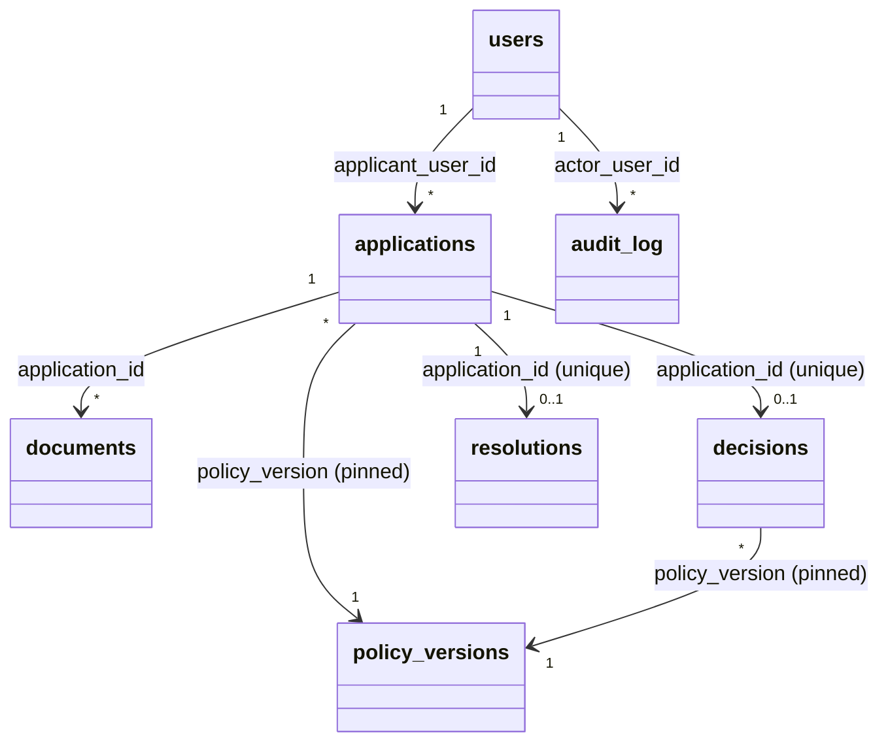

# Data models — TrueLend M1 (E1–E4)

Storage is SQLite via stdlib `sqlite3` (D-A). Money columns are `INTEGER`
paise (D-F); the Service layer is the only place a paise integer becomes a
`Decimal`, and the API layer is the only place a `Decimal` becomes a
2-decimal wire string (`config/money.py`). `annual_rate_pct` is stored as
`TEXT` for the same float-avoidance reason even though it is a rate, not
money. Timestamps are `TEXT` ISO-8601 UTC with a trailing `Z`. JSON columns
(`credit_flags`, `reason_codes`, `before`, `after`) are `TEXT` holding a
JSON-encoded value, validated at the Service boundary.

## `users`

| Field | Type | Constraints |
|---|---|---|
| id | INTEGER | PK, autoincrement |
| email | TEXT | unique, not null |
| password_hash | TEXT | not null (salted hash) |
| role | TEXT | not null, one of CUSTOMER/UNDERWRITER/POLICY_EDITOR/ADMIN |
| display_name | TEXT | not null |
| active | INTEGER | not null, 0/1, default 1 |

Example: `{id: 4, email: "customer1@example.test", role: "CUSTOMER", display_name: "Asha Rao", active: 1}`

## `audit_log` (insert-only; DB trigger aborts `UPDATE`/`DELETE`)

| Field | Type | Constraints |
|---|---|---|
| id | INTEGER | PK, autoincrement |
| occurred_at | TEXT | not null, UTC ISO-8601 |
| actor_user_id | INTEGER | not null, FK users.id |
| actor_role | TEXT | not null |
| action | TEXT | not null, one of the 9 FA-F0.4 actions |
| entity_type | TEXT | not null (e.g. `application`, `document`, `policy_version`) |
| entity_id | INTEGER | not null |
| correlation_id | TEXT | not null |
| reason_code | TEXT | nullable (override only) |
| comment | TEXT | nullable |
| before | TEXT | nullable, JSON |
| after | TEXT | nullable, JSON |

Index: `(entity_type, entity_id)`. Example:
`{id: 101, occurred_at: "2026-03-20T09:14:02Z", actor_user_id: 3, actor_role: "UNDERWRITER", action: "DOCUMENT_VERIFIED", entity_type: "document", entity_id: 1, correlation_id: "a1b2c3d4-...", reason_code: null, comment: "Name matches PAN record", before: null, after: null}`

## `schema_migrations`

| Field | Type | Constraints |
|---|---|---|
| filename | TEXT | PK |
| sha256 | TEXT | not null |
| applied_at | TEXT | not null |

## `policy_versions` (trigger aborts `DELETE` and any `UPDATE` other than the one `DRAFT`→`APPROVED` transition)

| Field | Type | Constraints |
|---|---|---|
| version | INTEGER | PK |
| status | TEXT | not null, DRAFT or APPROVED |
| file_path | TEXT | not null, e.g. `backend/policies/policy_v0002.json` |
| sha256 | TEXT | not null, hash of the file at creation; never recomputed after |
| base_version | INTEGER | nullable, FK policy_versions.version |
| created_by | INTEGER | not null, FK users.id |
| created_at | TEXT | not null |
| approved_by | INTEGER | nullable, FK users.id |
| approved_at | TEXT | nullable |

The **active** version is `SELECT MAX(version) WHERE status='APPROVED'`.
Example: `{version: 1, status: "APPROVED", file_path: "backend/policies/policy_v0001.json", sha256: "e3b0c4...", base_version: null, created_by: 1, created_at: "2026-01-01T00:00:00Z", approved_by: 1, approved_at: "2026-01-01T00:00:00Z"}`

### Policy file (JSON, not a DB table — `backend/policies/policy_v000N.json`)

```json
{
  "version": 1,
  "products": {
    "PERSONAL": {
      "min_age": 21, "max_age": 60,
      "min_income": "25000.00",
      "min_tenure_months": 12, "max_tenure_months": 60,
      "min_amount": "50000.00", "max_amount": "1500000.00",
      "annual_rate_pct": "12.00",
      "auto_reject_below_score": 600, "auto_approve_min_score": 700,
      "required_documents": ["ID_PROOF", "ADDRESS_PROOF", "SALARY_SLIP"]
    },
    "VEHICLE": { "...": "..." },
    "EDUCATION": { "...": "..." }
  },
  "reason_codes": {
    "INCOME_BELOW_MIN": "Income is below the minimum for this product.",
    "AGE_OUT_OF_RANGE": "Applicant age is outside the product's allowed range.",
    "SCORE_BELOW_MIN": "Credit score is below the auto-reject threshold.",
    "SCORE_MEETS_AUTO_APPROVE": "Credit score meets the auto-approve threshold.",
    "SCORE_IN_REVIEW_BAND": "Credit score falls in the manual-review band."
  },
  "override_reason_codes": ["COMPENSATING_FACTORS", "DATA_CORRECTION", "SENIOR_APPROVAL"]
}
```

## `applications`

| Field | Type | Constraints |
|---|---|---|
| id | INTEGER | PK, autoincrement |
| applicant_user_id | INTEGER | not null, FK users.id |
| product_type | TEXT | not null, PERSONAL/VEHICLE/EDUCATION |
| requested_amount_paise | INTEGER | not null, > 0 |
| tenure_months | INTEGER | not null |
| age_years | INTEGER | not null |
| monthly_income_paise | INTEGER | not null, >= 0 |
| credit_flags | TEXT | not null, JSON `{prior_default, missed_payment_12m, thin_file}` |
| pan | TEXT | not null, matches `[A-Z]{5}[0-9]{4}[A-Z]`, never returned raw |
| aadhaar | TEXT | not null, 12 digits, never returned raw |
| status | TEXT | not null, DRAFT/SUBMITTED/MANUAL_REVIEW/APPROVED/REJECTED |
| policy_version | INTEGER | nullable until submit, FK policy_versions.version |
| created_at | TEXT | not null |
| submitted_at | TEXT | nullable |

Index: `(applicant_user_id)`. `pan_masked`/`aadhaar_masked` (FA-F2.3) are
computed at the API boundary, never stored.

## `documents`

| Field | Type | Constraints |
|---|---|---|
| id | INTEGER | PK, autoincrement |
| application_id | INTEGER | not null, FK applications.id |
| type | TEXT | not null, one of the 6 M1 document types |
| status | TEXT | not null, MISSING/UPLOADED/VERIFIED/REJECTED |
| filename | TEXT | nullable (metadata only, FA-F2.5 — no file content) |
| reason | TEXT | nullable, 1-500 chars when set (verification outcome) |
| uploaded_at | TEXT | nullable |
| verified_by | INTEGER | nullable, FK users.id |
| verified_at | TEXT | nullable |

Index: `(application_id)`.

## `decisions` (insert-only; one row per application, unique on `application_id`)

| Field | Type | Constraints |
|---|---|---|
| id | INTEGER | PK, autoincrement |
| application_id | INTEGER | not null, unique, FK applications.id |
| decision | TEXT | not null, AUTO_APPROVE/AUTO_REJECT/MANUAL_REVIEW |
| score | INTEGER | not null, 300-900 |
| reason_codes | TEXT | not null, JSON array |
| policy_version | INTEGER | not null, FK policy_versions.version (the pinned one) |
| decided_at | TEXT | not null |

## `resolutions` (insert-only; one row per application, unique on `application_id`)

| Field | Type | Constraints |
|---|---|---|
| id | INTEGER | PK, autoincrement |
| application_id | INTEGER | not null, unique, FK applications.id |
| kind | TEXT | not null, MANUAL_REVIEW/OVERRIDE |
| outcome | TEXT | not null, APPROVED/REJECTED |
| reason_code | TEXT | nullable, required when kind=OVERRIDE (one of the policy's `override_reason_codes`) |
| comment | TEXT | not null, 1-500 chars |
| resolved_by | INTEGER | not null, FK users.id |
| resolved_at | TEXT | not null |

## Relationships


