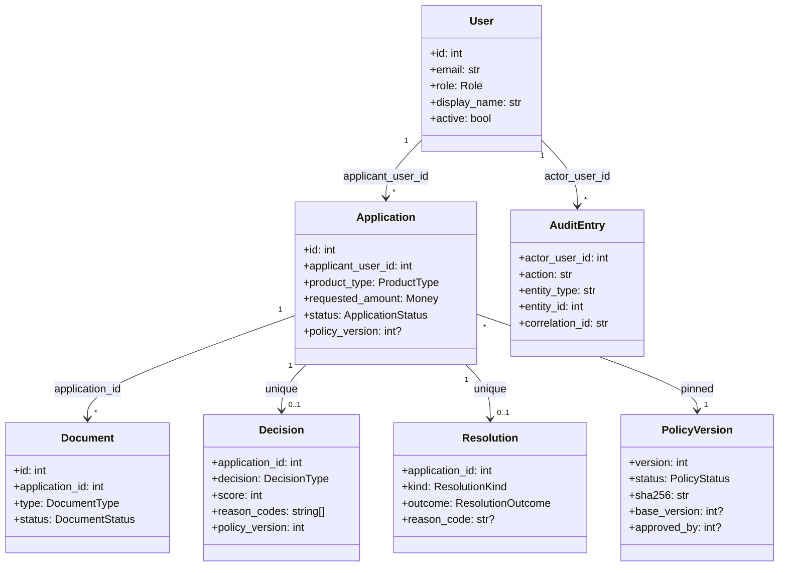

# REASONS Canvas — TrueLend M1 (E1–E4)

The narrative spine for this design set. Fix this Canvas first when a
requirement changes, then the code and the other design documents.

## Requirements

**Problem.** A lender needs a demo-ready loan origination and underwriting
system: a customer applies and uploads document metadata, an underwriter
verifies documents and resolves manual-review or auto-rejected decisions, a
policy editor adjusts thresholds without a code change, and every
underwriting-relevant action is auditable. M1 covers epics E1 (platform:
auth, audit, logging, health/migrations), E2 (catalog, apply, documents),
E3 (scoring, underwriting, review, override) and E4 (policy versions).
Repayment, disbursement and the admin dashboard are M2 and out of this
Canvas's scope.

**Definition of done.** Every acceptance criterion in
`specs/stories/E1-S1.md` through `E4-S2.md` passes against the running
backend/frontend; the architecture, float-money, and policy-immutability
tests (E1-S4, E4-S1) pass in CI; every FA-F0.1–F3.10 settled assumption is
honoured.

**Acceptance criteria this design realizes:** E1-S1-AC1..AC5, E1-S2-AC1..AC4,
E1-S3-AC1..AC5, E1-S4-AC1..AC5, E2-S1-AC1..AC5, E2-S2-AC1..AC5,
E2-S3-AC1..AC5, E2-S4-AC1..AC3, E3-S1-AC1..AC5, E3-S2-AC1..AC5,
E3-S3-AC1..AC6, E3-S4-AC1..AC3, E3-S5-AC1..AC5, E3-S6-AC1..AC3,
E4-S1-AC1..AC6, E4-S2-AC1..AC3.

## Entities

All entities below are **new** — `specs/brownfield/code-graph.json` contains
only five empty scaffold files (`backend/src/__init__.py`,
`backend/tests/__init__.py`, `frontend/eslint.config.mjs`,
`frontend/src/env.d.ts`, `frontend/vitest.config.ts`), none of which
represent a domain concept. This design extends nothing existing.

**Business rules.** An `Application`'s `status` is the only mutable state
after creation — `Decision` and `Resolution` are insert-only, one row each
per application (FA-F3 "Entities"). A `PolicyVersion`'s file never changes
after creation; only its DB row's `DRAFT → APPROVED` transition mutates
(FA-F1.2). `AuditEntry` rows are insert-only, enforced by a DB trigger
(NFR-02).

## Approach

**Chosen:** a strict five-layer backend (types → config → repository →
service → api) with three cross-epic seams expressed as Types-layer
Protocols (`AuthPrincipal`, `AuditWriter`, `ScoreFunction`, decision D-C),
and a Vite/React SPA consuming the same JSON wire contracts. Money is
integer paise in SQLite, `Decimal` in services, 2-decimal strings on the
wire (D-F) — one conversion point, not three independent ones.

**Rejected alternatives:**
- *SQLAlchemy ORM + Alembic* (for D-A) — rejected because FA-F0.5 requires
  checksummed, file-based migrations and NFR-02 requires a DB trigger that
  an ORM's unit-of-work would make easy to bypass accidentally.
- *Event-driven underwriting* (publish-then-handle instead of a direct
  service call) — rejected for M1; `ApplicationApproved` is published but
  has no M1 subscriber (FA-F3.10), so a synchronous call is simpler and the
  event exists only to keep F4 (M2, disbursement) from requiring a
  refactor of the underwriting service later.
- *Tailwind utility CSS* (for D-B) — rejected because `specs/ui_spec.md` §4
  commits to a token-only design system; Tailwind's utility classes would
  let a value bypass the token set, which the UI spec's accessibility and
  dark-mode-readiness work depends on staying closed.
- *Separate "interface" stories ahead of design* (for D-C) — rejected
  because `story-clusters.json` already flags the three Protocol contracts
  as blocking; adding stories for them would just move the blocking
  dependency instead of removing it. A zero-logic Types file resolves it
  for free.

## Structure

Matches `architecture.md`'s layer table and `folder-structure.md` exactly:
`backend/src/truelend/{types,config,repository,service,api}`,
`frontend/src/{types,config,service,api,ui}`. No module imports from a
higher layer (enforced by the E1-S4 layering test). Bounded contexts are
not configured (`project-manifest.json#architecture` has no `contexts`
block) — the layer check is the only structural gate in M1.

## Operations

Numbered per epic; each step names the file it lands in (feeding Governs).

1. **E1-S4** — `backend/src/truelend/types/{enums,errors,money,contracts}.py`:
   declare `Role`, `ApplicationStatus`, …, the three Protocols, `DomainError`
   hierarchy. `backend/src/truelend/config/db.py`: `run_migrations(conn,
   dir)` verifies each applied file's SHA-256 against `schema_migrations`
   before running anything new; aborts with `MIGRATION_CHECKSUM_MISMATCH`
   on mismatch. `backend/src/truelend/api/main.py`: app factory calling
   migrations then seed before accepting traffic.
2. **E1-S1** — `backend/src/truelend/service/auth_service.py`:
   `login(email, password) -> LoginResult | None` (uniform `None` on bad
   credentials); `resolve_principal(token) -> AuthPrincipal | None`.
   `backend/src/truelend/api/deps.py`: `get_current_principal()` FastAPI
   dependency, applied to every router except `auth_router.login` and
   `health_router`.
3. **E1-S2** — `backend/src/truelend/repository/audit_repo.py`:
   `AuditRepo.write(...)` implements `AuditWriter`, executed inside the
   caller's transaction so a rollback removes the audit row too.
4. **E1-S3** — `backend/src/truelend/api/middleware.py`: correlation-ID
   middleware runs first in the chain; `config/logging.py`'s redaction
   filter wraps every handler, including the 500 exception path.
5. **E2-S1 → E2-S2 → E2-S3** (sequential, same or dependent clusters) —
   `service/policy_service.get_active_catalog()` →
   `service/application_service.apply()` (validates range against that
   catalog, inserts the checklist) → `service/document_service.upload_document()`
   / `submit()` (blocks submit on any non-`UPLOADED+` row, pins
   `policy_version`).
6. **E3-S2 → E3-S3 → E3-S4** — `service/scoring.score()` (pure) feeds
   `service/underwriting_service.RuleEngine.evaluate()`, which checks the
   income floor first (raising `PolicyViolationException` for E3-S4), then
   age range, then score thresholds (FA-F3.3 order); `underwrite()` persists
   exactly one `decisions` row per application and maps to `applications.status`.
7. **E3-S1, E3-S5** — `service/verification_service.decide_document()` and
   `service/review_service.{review,override}()` each write their audit row
   in the same transaction as the state change (E1-S2-AC4's "no orphan
   audit row on 409" rule).
8. **E4-S1** — `service/policy_service.create_policy()` validates FA-F1.6
   ranges before writing `policy_v000N.json`; `approve_policy()` only
   updates the DB row, never the file or its hash.
9. **E2-S4, E3-S6, E4-S2** — frontend `service/*.ts` TanStack Query hooks
   call the above endpoints; `ui/apply`, `ui/verification`, `ui/decision`,
   `ui/policy` render from the shared `ui/components` library E2-S4 ships
   first.

## Norms

- **Naming:** domain terms match `specs/app_spec.md` / `specs/features/F0-F3`
  verbatim (`PolicyViolationException`, `ApplicationApproved`,
  `AUTO_APPROVE`/`AUTO_REJECT`/`MANUAL_REVIEW`) — no invented synonym.
- **Dependency injection:** FastAPI `Depends()` only; a service never
  imports a concrete repository or router directly — it receives the
  Protocol-typed dependency through its constructor or function parameter.
- **Logging:** one JSON line per request via the shared `config/logging.py`
  formatter; no service or repository calls `print` or a bare `logging`
  call outside that module.
- **Error handling:** every service raises a `DomainError` subclass; the
  API layer is the only place that maps an error to HTTP status +
  envelope. Nothing is silently swallowed — a caught exception is either
  re-raised as a `DomainError` or explicitly persisted (the one exception:
  `PolicyViolationException`, which is caught by design and turned into a
  recorded `AUTO_REJECT`, FA-F3.4).
- **Data types:** `Decimal` for money end-to-end in Python; `string` for
  money end-to-end in TypeScript and JSON. No story's code introduces a
  `float`/`Number` on a money value — this project has no `kind: "norm"`
  entries in `specs/brd/brd-safeguards.json` to cite here; the rule is
  carried instead by decision D-F and enforced by the E1-S4 static scan.

## Safeguards

Every `specs/brd/brd-safeguards.json` entry, cited here because all twelve
are `kind: "forbidden_action"` (none is `kind: "norm"`):

- **SG-1** — no real bureau or credit-score integration; `service/scoring.py`
  is a fixed, pure formula (E3-S2), never an external call.
- **SG-2** — no real document OCR or extraction; `upload_document()` stores
  `{type, filename}` only (E2-S3), never file bytes.
- **SG-3** — no real disbursement rails (NEFT/RTGS/IMPS). M1 builds no
  disbursement endpoint at all; this boundary is drawn by omission, not a
  stub inside scope.
- **SG-4** — no real collections or recovery workflow; out of M1 by
  omission, same as SG-3.
- **SG-5** — no multi-currency or FX; `Money` is always INR, never
  parameterized by currency, in `types/money.py`.
- **SG-6** — no production deployment, secret manager, multi-region, or
  distributed locking; `deployment.md` is a local Compose run only, and
  `TRUELEND_JWT_SECRET` is a plain environment variable, not a managed
  secret.
- **SG-7** — no late fees, penal interest, prepayment rebates, foreclosure
  quotes, or schedule regeneration; M1 has no repayment schedule at all
  (M2), so none of these can exist yet.
- **SG-8** — no co-applicants, no editing an application after submission,
  no withdrawal; `application_service.py` exposes no update-after-submit or
  delete path, and `documents_repo.py`'s only post-submit write is the
  verification outcome.
- **SG-9** — no token refresh, password reset, or user administration;
  `auth_service.py` exposes only `login` and principal resolution; users
  are seed data only (E1-S4).
- **SG-10** — no fourth product type, no editable score weights through the
  policy editor, no rollback of an approved policy version;
  `policy_service.create_policy()` validates against exactly `PERSONAL`,
  `VEHICLE`, `EDUCATION`, the score formula lives in code
  (`service/scoring.py`) not the policy file, and there is no un-approve
  code path (FA-F1.2).
- **SG-11** — no report export, time-series trends, or notifications; M1
  ships no admin dashboard (M2), so none of these surfaces exist yet.
- **SG-12** — nothing in M1 depends on the optional AI runtime (D-H); every
  flow above is reachable with `AI` entirely absent from the deployment.

## Governs

- `backend/src/truelend/types/enums.py`
- `backend/src/truelend/types/errors.py`
- `backend/src/truelend/types/money.py`
- `backend/src/truelend/types/contracts.py`
- `backend/src/truelend/config/settings.py`
- `backend/src/truelend/config/errors.py`
- `backend/src/truelend/config/db.py`
- `backend/src/truelend/config/money.py`
- `backend/src/truelend/config/logging.py`
- `backend/src/truelend/api/main.py`
- `backend/src/truelend/api/health_router.py`
- `backend/src/truelend/api/middleware.py`
- `backend/src/truelend/api/deps.py`
- `backend/src/truelend/api/auth_router.py`
- `backend/src/truelend/api/audit_router.py`
- `backend/src/truelend/api/products_router.py`
- `backend/src/truelend/api/policies_router.py`
- `backend/src/truelend/api/applications_router.py`
- `backend/src/truelend/api/documents_router.py`
- `backend/src/truelend/repository/users_repo.py`
- `backend/src/truelend/repository/audit_repo.py`
- `backend/src/truelend/repository/policy_repo.py`
- `backend/src/truelend/repository/applications_repo.py`
- `backend/src/truelend/repository/documents_repo.py`
- `backend/src/truelend/repository/decisions_repo.py`
- `backend/src/truelend/repository/resolutions_repo.py`
- `backend/src/truelend/service/auth_service.py`
- `backend/src/truelend/service/policy_service.py`
- `backend/src/truelend/service/application_service.py`
- `backend/src/truelend/service/document_service.py`
- `backend/src/truelend/service/verification_service.py`
- `backend/src/truelend/service/scoring.py`
- `backend/src/truelend/service/underwriting_service.py`
- `backend/src/truelend/service/review_service.py`
- `backend/migrations/0001_users_and_audit.sql`
- `backend/migrations/0002_policy_versions.sql`
- `backend/migrations/0003_applications_and_documents.sql`
- `backend/migrations/0004_decisions_and_resolutions.sql`
- `backend/policies/policy_v0001.json`
- `frontend/src/types/*`
- `frontend/src/config/messages.ts`
- `frontend/src/config/tokens.css`
- `frontend/src/api/httpClient.ts`
- `frontend/src/api/authContext.ts`
- `frontend/src/service/products.ts`
- `frontend/src/service/applications.ts`
- `frontend/src/service/documents.ts`
- `frontend/src/service/verification.ts`
- `frontend/src/service/decisions.ts`
- `frontend/src/service/policies.ts`
- `frontend/src/ui/apply/*`
- `frontend/src/ui/verification/*`
- `frontend/src/ui/decision/*`
- `frontend/src/ui/policy/*`
- `frontend/src/ui/components/*`
